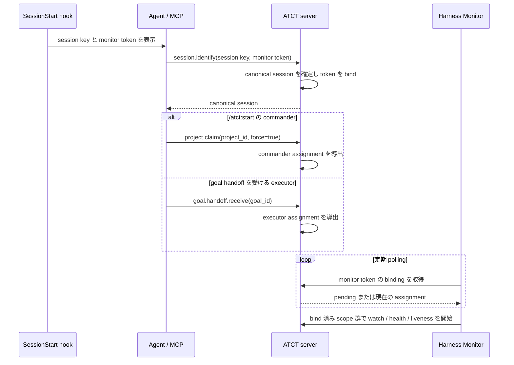

# Bootstrap

ATCT server は canonical session に紐づく claim と handoff から role と scope を導出する。
monitor はその assignment を token で取得する。

# Agent 共通

## 用語

| 用語 | 意味 |
| --- | --- |
| session key | harness の SessionStart が出す不透明な `session_id`。agent は変更せず identify に渡す。 |
| canonical session | session key に結び付いた ATCT の agent session。claim と handoff の所有者である。 |
| assignment | canonical session から導出した role と scope の組。role は commander / executor（goal handoff の保有者）。何も持たない session は role を持たない。 |
| monitor token | monitor process と canonical session を結ぶ不透明な識別子。agent は SessionStart で受け取り identify に渡し、monitor は binding の取得に使う。 |
| scope | commander の project、executor の goal。 |

## 起動フロー

role を作るのは `session.identify` ではなく、project claim または handoff の受領である。monitor の接続方法は
harness ごとに異なるが、bind 後に監視を始める流れは共通である。



`session.identify` は identity を結ぶだけで role を作らない。claim または handoff の受領が成功した応答で
assignment が更新され、monitor は次の polling でその binding を観測する。agent は必要なら `atct_role` で導出結果を診断できる。

## assignment を作る起動操作

session を identify した直後に、起動元と受領者が次の操作を行う。handoff を作る側は新しい
monitor session を起動し、受領者に対象 ID を渡す。

| 起動する role | 起動元が先に行うこと | 起動した session が行うこと | bind 結果 |
| --- | --- | --- | --- |
| commander | — | `/atct:start`: `atct_goal_list` で project ID を得て、`atct_project_claim(project_id, force=true)` | project scope |
| executor | commander が `atct_goal_handoff_request` し、goal ID を渡す | `atct_goal_handoff_receive(goal_id)` | goal scope |

project claim は commander を作る。goal handoff の request は受領者の assignment をまだ変えず、
受領者が receive したときにだけ変える。

## 原則

- role は server が導出する。
- authorization は server が canonical session から毎回判定する。monitor の scope は通知・health・liveness
  の配送先を決めるだけで、権限を与えない。
- `atct_role` は agent が role を診断する API として残す。通常の monitor bind の入力にはしない。

## assignment の導出

server は状態を次の順で評価する。

| role | 導出根拠 | scope |
| --- | --- | --- |
| commander | project claim を canonical session が保有する | その project |
| executor | open かつ受領済みの goal handoff を canonical session が保有する | その goal |

複数の根拠がある場合も server が明確な優先順位を返す。
何も保有しない session（goal handoff を閉じた後を含む）は role も scope も持たない。

## scope の更新

assignment は起動時だけの固定値ではない。project claim、goal handoff の receive・review・complete・
recovery で変化する。server は該当 canonical session の assignment を再計算し、monitor は token の binding
endpoint を定期 polling して更新を取得する。server から monitor への push は行わない。

monitor は bind 前には agent action を配送せず、project 全体を仮の executor scope として監視しない。
bind 後に scope ごとの snapshot を取得してから event を処理するため、識別中の通知を取りこぼさない。
assignment が空になった monitor は health と liveness を停止し、次の bind 更新を待つ。

# Claude

Claude は通常の session として開始する。SessionStart hook が session key を表示し、agent は共通フローに従って
identify と assignment を確立する。

Claude Watch は既に起動した session に後から attach できる。agent は SessionStart の token を identify に渡す。
Watch は Monitor ツールで `atct watch --monitor --token <monitor_token>` として起動し（待つだけだった Monitor の後は `--once` を付けた background の Bash）、token の binding を polling して scope を更新する。

# Codex

Codex は、monitor wrapper が新しい interactive process を起動する。通常の Codex process を後から monitor に
変えることはできない。

`atct codex monitor` は共通の monitor token を生成し、子の Codex process に注入する。SessionStart がその値を
agent に渡し、最初の `atct_session_identify` が session key とともに server へ送る。

## 起動

Codex は常に次で起動する。

```sh
atct codex monitor -- <codex args>
```

新しい session はこの入口から起動する。

## 通知

Codex Bridge は bind 済み scope の通知を queue へ入れ、Codex thread が idle になった時に turn input として渡す。
event / wakeup の条件と内容は Agent 共通であり、Claude Watch と異なるのは配送方法だけである。
