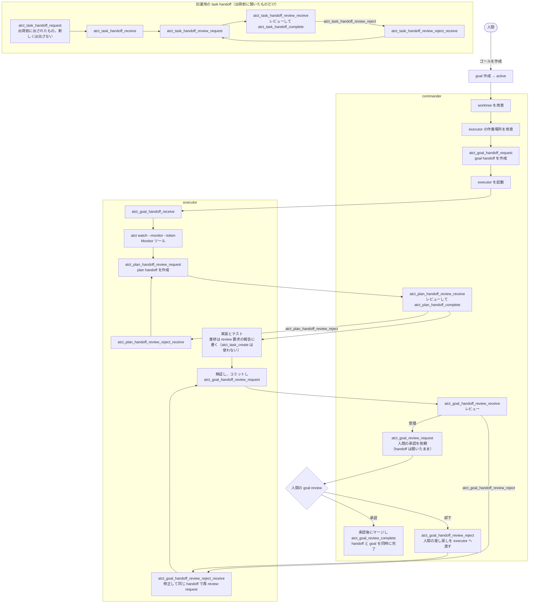

# 実行フロー: commander / executor

ATCT の実行フローである。各層はここに定めた責務と handoff の状態遷移に従う。

役割は commander と executor の 2 層である。executor は、受領済みで未完了の goal handoff を持つ
session の名前で、ゴールの設計から報告までを 1 つの session が担う。DB、HTTP API、コードの内部名
`subcommander` は変えていない。利用者に見える名前（`atct_role`、skill、hook の文面、dashboard）だけが
この文書の名前になる。

## 設計の原則

1. **worktree が分離を担う。**ゴールごとに worktree を 1 つ持ち、衝突は main への
   マージ時に commander が解決する。
2. **順序は状態で守る。**通常の順序違反は状態遷移で拒否し、復旧可能な失敗はその状態から
   回復する。
3. **1 つの事実に 1 つの書き手を置く。**handoff の受理記録と、goal の完成報告は
   保存先と目的が異なる事実として扱う。
4. **設計から報告までを 1 つの executor が行う。**executor は設計・実装・検証・コミット・報告を
   担う。sub-agent を使うかは executor が決める。ATCT は sub-agent を知らない。

## spec / plan の置き場所

ATCT 管理下の作業では、spec と plan は goal の `spec` / `plan` フィールドへ
`atct_goal_update_request_report` で全文を書く。`doc/specs/`・`doc/plans/`・
`docs/superpowers/` にファイルを足さない。「詳細は doc/plans/x.md」のように参照だけを
フィールドに書くことも許されず、拒否される。

superpowers（brainstorming・writing-plans）の既定の保存先や、`doc/specs`・`doc/plans` を
指す個人設定と食い違うときは、ATCT 管理下では goal のフィールドが優先する。これらの
ディレクトリにある既存のファイルは削除も移行もしない。

## 層と責務

| 層 | やること |
|---|---|
| `commander` | ゴールの分割、worktree の用意、executor の起動と終了、設計（plan）とゴール変更のレビュー、executor の依頼を受けた人間への決定の起票、最終報告、マージ、公開、後片付け |
| `executor` | ゴールの設計、実装、テスト、ゴール内のコミット、報告（goal handoff の review 要求）、人間への決定の依頼（commander が起票する）。task は進捗を記録するための任意の記録 |

## 役割とセッション

`atct_role` は daemon が handoff/claim の保有状態から導出する役割を返す。

| 判定順 | 条件 | 役割 |
|---|---|---|
| 1 | project claim を保有 | `commander` |
| 2 | 受領済みで未完了の goal handoff を保有 | `executor`（`goal_id` つき） |
| 3 | 受領済みで未完了の task handoff を保有 | `task_worker`（旧運用の残りを終えるためだけの名前） |
| 4 | どれも保有しない | `none` |

goal handoff を閉じると、その session は `none` になる。`expected_role=executor` は `goal_id` を持つ
goal handoff の保有者と `task_worker` に一致し、`none` はどの値にも一致しないので、役割を失った session は
確認をすり抜けない。

出荷前に起動した session のために、次の 2 つの互換を残す。どちらも内部名を改名する段階で外す。

- `expected_role=subcommander` は goal handoff の保有者（見える名前は `executor`）にだけ一致する古い名前で、`task_worker` には一致しない
- `expected_role=executor` は `task_worker` にも一致する

task claim/release は agent 向けの MCP/RPC として公開しない。goal の実装の所有権は、commander が
request し executor が receive した goal handoff で表す。

task/goal handoff を receive する worker は、SessionStart の正確な `session_key` を渡す。
`monitor_token` が発行されている場合は併せて渡す。MCP shim は receive の前にその鍵で
canonical な agent session を確定し、receive は role と claim evidence を返す。
`atct_role` は継続作業の前提ではなく、役割異常の診断に使う。

1 つのクライアントは複数の MCP transport を開き、再接続や daemon 再起動でさらに増える。
transport 1 本につき agent_sessions 行は 1 件だけ作られる。Claude Code の `server/discover`
には行を作らない。`session.identify` を一度も実行していない行は何も保有しない。そのため `atct_role` はその行を拒否し、`atct_session_identify` を
呼ぶよう伝えるエラーを返す。そのような行からの RPC が失敗した場合も、同じ案内がエラーに付く。
同じ `session_key` で `session.identify` を実行すると canonical な行に再接続されるので、
claim と monitor は同じ行に残る。クライアントを区別する列は無いため、代わりに `/mcp` ハンドラが
登録ごとにリモートアドレスと user-agent をログに残す。

Claude Code では、一度識別した session が新しい transport へ移るときの再識別が自動で行われ、
`atct_session_identify` は要らない（`session_key` を DB が一度も見ていない最初の呼び出しだけは、
従来どおり identify か handoff の receive が登録する）。PreToolUse hook
（`atct monitor-check`）が ATCT のツール呼び出しの `tool_use_id` を `session.tool_use.bind` で
daemon に登録する。MCP 側は同じ呼び出しの `_meta["claudecode/toolUseId"]` を読み、
`session.tool_use.resolve` で canonical な行へ接続し直す。binding は 30 分で切れ、daemon の
再起動で消える。hook の無い client（Codex など）は `_meta` を持たないため、従来どおり
`atct_session_identify` を呼ぶ。

## handoff の状態

| 状態 | 遷移させる者 | `goal` | `plan` | `task`（旧運用） |
|---|---|---|---|---|
| 依頼 | 渡す側 | `atct_goal_handoff_request` | — | `atct_task_handoff_request` |
| 受領 | 作業する側 | `atct_goal_handoff_receive` | — | `atct_task_handoff_receive` |
| レビュー依頼 | 作業する側 | `atct_goal_handoff_review_request` | `atct_plan_handoff_review_request` | `atct_task_handoff_review_request` |
| レビュー受領 | レビューする側 | `atct_goal_handoff_review_receive` | `atct_plan_handoff_review_receive` | `atct_task_handoff_review_receive` |
| 完了 | 渡した側 | `atct_goal_review_complete`（人間承認後） | `atct_plan_handoff_complete` | `atct_task_handoff_complete` |
| 差し戻し | 渡した側 | `atct_goal_handoff_review_reject` | `atct_plan_handoff_review_reject` | `atct_task_handoff_review_reject` |
| 差し戻し受領 | 作業する側 | `atct_goal_handoff_review_reject_receive` | `atct_plan_handoff_review_reject_receive` | `atct_task_handoff_review_reject_receive` |

| handoff | 誰から誰へ | レビューする者 |
|---|---|---|
| `goal` | commander → executor | commander |
| `plan` | executor → commander | commander |
| `task`（旧運用） | executor → task worker | executor |

`plan` は設計成果物を上位層へ渡すため、request/receive を持たず review request から始まる。
作業した側は自身の handoff を閉じない。差し戻しは handoff を閉じず、受領済みの状態へ
戻すため、作業者は同じ handoff で修正と再レビューを行う。

### task-create handoff

plan handoff の完了時に、daemon は `task.create_handoff.request` を自動生成する。agent が呼ぶ
`atct_task_handoff_create_request` は存在しない。executor はこの handoff を受領しなくてよい。この版では
task を作らない。task を作ると、daemon が task handoff の委譲（`atct_task_handoff_request`）を促し続けるためである。
goal は task なしで完了でき、`atct_goal_handoff_review_request` は task の状態を見ない。受領しなければ
stop-check は止めず、review 要求のときに daemon が handoff を取り下げる。進捗は review 要求の報告に書く。

goal handoff の review が差し戻されたときも、daemon は task-create handoff を発行する（requested_by は
差し戻した commander）。これも受領しない。すでに open な task-create handoff があれば新規には作らず、それを再利用する。受領する前に
goal review が再度 request されたときは、その handoff を「superseded」として閉じる（受領済みのものは
閉じない）。

## MCP ツールの応答

状態を変える MCP ツールは受領票を返す。`internal/mcpshim` が daemon の応答から報告の
全文（spec・plan・各報告・entries・history・description・question など）を落とし、id・状態・
時刻・`next_step`・`role`・`claim_evidence` を残す。全文は `atct_goal_get` と
`atct_goal_handoff_entry_history` / `atct_handoff_entry_history` で読む。

- `atct_*_handoff_review_receive` と `atct_*_handoff_review_reject_receive` は、届けることが
  役目の報告 1 つ（`ReviewRequestReport` / `ReviewRejectReport`）だけを残す。plan handoff には
  履歴を読むツールが無いため、ここが報告を読む唯一の入口になる
- `unapplied_decisions` は、そのセッションへ前回返した一覧から変わったときだけ付く。変わって
  いないときは `unapplied_count` だけ、0 件に変わったときは `[]`。`atct_goal_list` は常に全文
- `atct_goal_get` は省略可能な `fields`（goal の項目名・`tasks`・`task_summary`・`goal_review`）で
  返す項目を絞れる。省略時は全文、未知の名前は拒否
- 整形は MCP shim だけで行う。daemon の RPC、CLI、HTTP API、web は全文を返したまま

## タスクの状態遷移

旧運用の task handoff では、handoff 遷移が task status を更新する。

| handoff の遷移 | `tasks.status` |
|---|---|
| `atct_task_handoff_request` | `todo` |
| `atct_task_handoff_receive` | `doing` |
| `atct_task_handoff_review_request` | `review` |
| `atct_task_handoff_complete` | `done` |
| `atct_task_handoff_review_reject` | `doing` |

## 全体フロー

### commander

1. ゴールごとの worktree を用意する。
2. executor の作業場所を用意し、`atct_goal_handoff_request` を記録してから起動する。
3. plan review の通知を受けたら `atct_plan_handoff_review_receive` で受領して設計を
   レビューし、受理なら `atct_plan_handoff_complete`、差し戻しなら
   `atct_plan_handoff_review_reject` を呼ぶ。
4. goal review の通知を受けたら `atct_goal_handoff_review_receive` で受領してレビューする。
   差し戻す場合は `atct_goal_handoff_review_reject` を呼ぶ。受理した handoff は開いたままにし、
   人間の review へ進める。
5. `atct_goal_review_request` で人間の review を依頼する。**人間が承認するまで main へは
   マージしない。**承認後にマージして `atct_goal_review_complete` を呼ぶ。この操作は
   goal handoff と goal を同じ transaction で完了する。worktree・branch・workspace は
   commander が「worktree・branch・workspace の回収」に従って回収する。
6. 人間が却下した場合は、通知を受けた commander がフィードバックを添えて
   `atct_goal_handoff_review_reject` を呼ぶ。新しい handoff は作らない。

### executor

1. `atct_goal_handoff_receive` に SessionStart の `session_key` と必要なら
   `monitor_token` を渡して、goal を受領する。
2. `atct watch --monitor --token <monitor_token>` を Monitor ツールで開始する。
   30 分の期限切れで配送数が 0 だったときだけ、`--once` を付けた background の
   Bash に切り替える。scope はサーバーが
   assignment から導出するので、goal や project を渡さない。token 無しの
   `atct watch` は人間用の診断ビューで、どのセッションの watch にもならない
   （`atct:atct` スキルの `## Watch` を参照）。
3. `superpowers:brainstorming` と `superpowers:writing-plans` で設計し、
   canonical spec と plan を `atct_goal_update_request_report` へ保存して
   `atct_plan_handoff_review_request` で plan handoff を作成する。
   差し戻しを受けた場合は `atct_plan_handoff_review_reject_receive` を呼んでから、
   同じ `handoff_id` で `atct_plan_handoff_review_request` を呼び、修正した plan の
   review を再開する。この遷移は既存の plan handoff を再利用し、新しい handoff は作らない。
4. plan が承認されたら、task を作らずに実装と検証へ進む。この版では task を作らない（task を作ると
   daemon が task handoff の委譲を促し続ける）。plan の完了で生成された task-create handoff は受領しない
   （「task-create handoff」を参照）。進捗は review 要求の報告に書く。
5. `superpowers:test-driven-development` に従って実装とテストを行い、
   `superpowers:verification-before-completion` で検証する。sub-agent を使うかは executor が決める。
   ATCT は sub-agent を知らず、sub-agent に ATCT を呼ばせない。
6. 変更をコミットし（パスを明示する）、`atct_goal_handoff_review_request` を出す。報告には、実行した
   command とその結果、実行できなかった検証を書く。
7. goal handoff が差し戻された場合は `atct_goal_handoff_review_reject_receive` を呼び、修正後に同じ
   `handoff_id` で `atct_goal_handoff_review_request` を出す。差し戻しで daemon が発行した
   task-create handoff は受領しない。
8. 人間への決定が要るときは `atct_decision_ask` を呼ばない。goal handoff へ `review_requested` の
   entry を足して commander に頼み、commander が起票する。

### 旧運用の task handoff

task handoff は新しく始めない。出荷前に開いた task handoff だけが、次の旧手順で終わる。受領した
session の役割は `task_worker` で、review と完了は executor（goal handoff の保有者）が行う。

1. task worker: `atct_task_handoff_receive` に SessionStart の `session_key` と必要なら
   `monitor_token` を渡して、渡された task を受領する。`atct_role` で役割を確かめた後、
   `atct_handoff_entry_history` で `handoff_id` と `task_id` を指定して依頼内容
   （`request_report`）を読み、それを作業の根拠にする。依頼内容が空か不足なら（履歴の request エントリの本文が `requested` だけなら依頼内容は無い）作業せず、
   `atct_task_handoff_review_request` の `review_request_report` を
   `blocked: 依頼内容が無い（何が足りないか）` にして返す。
2. task worker: `superpowers:test-driven-development` に従って実装とテストを行い、
   `superpowers:verification-before-completion` の検証後、`atct_task_handoff_review_request` を出す。
3. executor: review request を受領してレビューし、受理なら `atct_task_handoff_complete`、差し戻しなら
   `atct_task_handoff_review_reject` を呼ぶ。
4. task worker: 差し戻された場合は `atct_task_handoff_review_reject_receive` を呼び、同じ task
   handoff で修正して再び review request を出す。

## 人間のレビュー

`atct_goal_review_*` は handoff のレビューではなく、ゴールそのもののレビューである。
commander は goal handoff の review を受領してから human review を依頼する。その間 handoff は
開いたままであり、承認後の `atct_goal_review_complete` が main へのマージ後に handoff と goal を
同時に完了する。人間の却下は handoff の差し戻しへ変換され、同じ handoff で作業を再開する。
commander が交代した後は、現在の commander が `atct_goal_review_complete` と `atct_goal_handoff_review_reject` をそのまま実行でき、`atct_goal_review_request` だけは先に `atct_goal_handoff_review_receive` で受領し直す必要がある（`atct_handoff_recover` は不要で、claim を失った前の commander はどれも実行できない）。

**この承認が main へマージしてよい唯一の条件である。**「main へのマージは人間の承認が
唯一の条件である」を参照。

## 通知

各層は自身の watch から通知を直接受ける。レビューと再開は通知で始める。

| イベント | 呼ぶ者 | 届く先 |
|---|---|---|
| `atct_plan_handoff_review_request` | executor | commander |
| `atct_plan_handoff_complete` / `_review_reject` | commander | executor |
| `task.create_handoff.request` | daemon（plan handoff 完了時） | executor（受領は任意） |
| `atct_goal_handoff_review_request` | executor | commander |
| `goal.handoff.complete` | daemon（`atct_goal_review_complete` 時） | executor |
| `atct_goal_handoff_review_reject` | commander | executor |
| `atct_goal_review_reject` | 人間 | commander（`goal.review.reject` 通知） |
| `atct_goal_review_complete` | commander（人間の承認後） | — |
| ゴールの取り下げ | commander | そのゴールの executor |
| `atct_task_handoff_review_request`（旧運用） | task worker | executor |
| `atct_task_handoff_complete` / `_review_reject`（旧運用） | executor | task worker |

handoff の記録（`handoff_entry_added`）のうち、lifecycle の写し（`request`・`received`・`completed`、ack の `review_received`）は通知しない。`review_requested`・`review_rejected` と、参加者が `atct_*handoff_entry_append` で足した note は従来どおり通知する。

## 待機中の Stop hook

相手の応答（commander の plan / goal review、旧運用の task review）を待つだけの session は、生きた Monitor があれば Stop hook で止めない。executor は plan review・goal review と、旧運用の task handoff の起動・作業のいずれかを待つ間の open goal handoff、task worker は review 依頼済みで差し戻されていない task handoff が対象。差し戻し、受領済みの task-create handoff、旧運用の task review など他の block と、Monitor が無い場合（未受領の task handoff も止める）、取得に失敗した場合は従来どおり止める。詳細は `atct continuous-execution` で読める。

同じ状態で 2 回目の停止は止めない。daemon が session ごとに、直前に止めたときの理由と、その判定が読んだ状態（goal・handoff・task・decision の状態と時刻、生きた Monitor の有無）をメモリに覚え、理由も状態も同じなら block しない。最初の 1 回は必ず止め、理由か状態が変わればまた止める。記録は daemon の再起動で消える（再起動後は 1 回止まる）。

## アーカイブした project

`atct project archive <name|id>`（または dashboard の「プロジェクト」セクション）で project をアーカイブできる。goal・task・decision は消えずに残るが、dashboard の一覧・回答待ち、各役割の Stop hook の残作業、watch の通知、wakeup、期限切れ default の自動適用の対象から外れる。goal 詳細や task 詳細など ID を直接開く読み取りは使える。

archived な project に対する変更系（goal の作成・claim、handoff、task の変更、decision の ask / poll / withdraw、plan / review の要求）は、RPC でも HTTP（409）でも、project 名と `atct project unarchive <name>` を含む理由で拒否される。`project.release` は通る。解除は `atct project unarchive <name|id>` か dashboard から行い、解除すると元に戻る。archive 中に期限が切れた default は、解除後の最初の maintenance でまとめて適用される。アーカイブは人間の依頼があったときだけ commander が CLI から行う。MCP tool は無く、executor は行わない。

## worktree とコミット

- ゴール 1 つに worktree 1 つ、executor 1 人を対応させる。
- executor は着手時と goal review の前に `git merge main` を行う。権限内で
  解決できない衝突は commander へ返す。**これは main から worktree への向きだけである。**
- executor は goal handoff の review を要求する前に、未コミットの変更がなく、検証の結果を
  報告に書いたことを確認する。

### main へのマージは人間の承認が唯一の条件である

**worktree を main へマージしてよいのは、そのゴールの `atct_goal_review_request` に
人間が approve で答えた後だけである。**他に代わる条件は無い。

- commander review を受理しただけでは足りない。受理は人間へ回す前段であり、許可ではない
- タスクが全部 done でも、テストが全部通っても、急いでいても、許可にはならない
- 人間の却下・保留・未応答は、いずれも「マージしてはならない」である
- 承認は goal ごとである。あるゴールの承認は別のゴールのマージを許さない

**この条件を確かめずに `git merge` / `git push` / `git cherry-pick` で main を進めない。**
確かめ方は `atct_decision_poll` か `atct pending` で、そのゴールの `goal_review` decision が
`approve` で applied になっていること。

マージ後は `atct_goal_review_complete` を呼ぶ。これは記録であって許可ではないので、
先に呼んでマージの根拠にしてはならない。承認後（と取り下げ後）の後片付けは
commander が行う。「worktree・branch・workspace の回収」を参照。

## worktree・branch・workspace の回収

**回収するのは commander だけである。**executor は回収しない。自分の
worktree の中から自分を消せないからである。

- **いつ**: `atct_goal_review_complete` の直後（done）と、`atct_goal_withdraw` の直後（dropped）。
- **回収漏れの節目**: Goal 272 の節目と揃える。commander の最初の Look（`atct_goal_list`）と、
  `atct_goal_review_complete` 後の次の Look。`git worktree list` の `.worktrees/<id>` と
  `atct_goal_list` の active goal id を突き合わせる。active に無い id は `atct_goal_get` で
  status を確認し、done / dropped のものだけを回収する。active など他の status、または
  確認できないものは触らない。`git branch --list 'wt/goal-*'` で branch の残りも見る。
  回収漏れの検出用コードは無い。この 2 コマンドで足りる。

### 手順

1. 上の status 確認。スクリプトは goal の status を確かめない（DB に触れない）ので、
   この確認は必須である。
2. 主チェックアウトで `atct worktree-reclaim <id>` を実行する。
3. executor の workspace を閉じる。旧運用の task worker の session が残っていれば、それも終える。workspace の用意と片付けの手段（マルチプレクサ・ターミナル・別プロセス）は ATCT の外で決める。
   `## One workspace per goal` は dropped にも適用する。

パスと branch 名は `.worktrees/<id>` と `wt/goal-<id>`（整数 id）である。

### スクリプトの挙動

- 未コミットの変更（merge 途中を含む）は、goal 自身の branch へ
  `snapshot: abandoned worktree of goal <id>` として commit してから、`--force` なしで
  worktree を外す。
- main に merge 済みの branch だけ `git branch -d` で消す。未 merge の branch
  （スナップショットを含む）は残し、commit 数を表示する。スナップショット後に残った branch は、
  中身を確認してから commander が消す。
- ignored のもの（web/node_modules の symlink、コピーした web/dist）は再生成できるので捨てる。
- worktree の HEAD が `wt/goal-<id>` でない場合、または rebase・cherry-pick・revert・bisect
  の途中の場合は、exit 1 で何も消さずに中断する。commander が worktree を開いて手で
  片づけてから再実行する。

### 手作業で stash を使わない理由

実測（2026-10-03）: `git stash push -u` は unmerged paths があると失敗し、後続の
`git worktree remove --force` で goal 228 の未コミットの変更を失った。stash は全 worktree 共有の
1 本のスタックで goal に結びつかない。`--force` で worktree を消さない。
